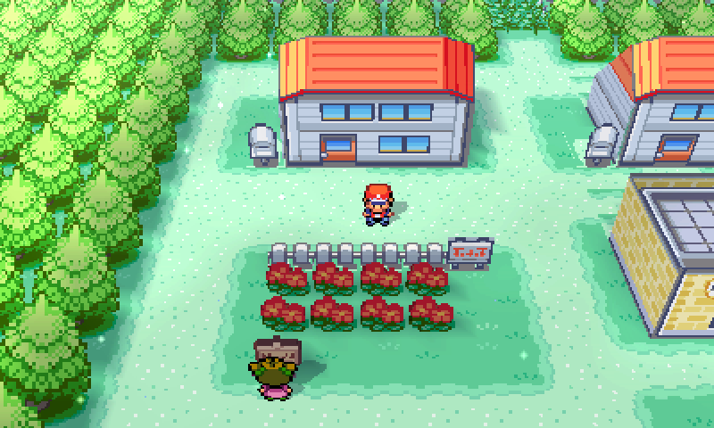
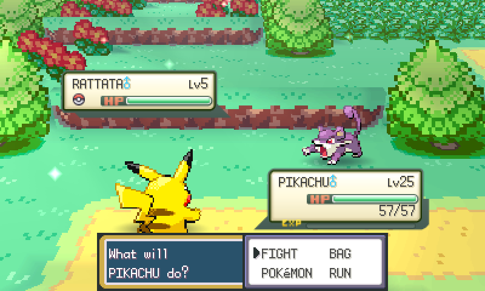
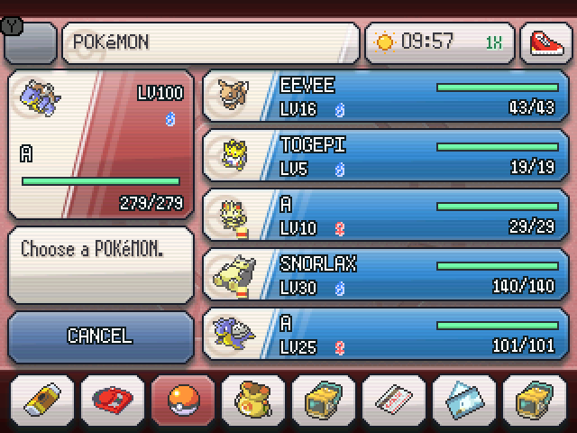

# FireRed Evolv3D

FireRed Evolv3D brings FireRed Evolved to native Nintendo 3DS homebrew.

Current beta: **v0.2.46**, synchronized with FireRed Evolved’s shared encounter rules and event scripts.

## How to Play

1. Open the [3DS patcher](https://niceliketryce.github.io/FireRed-Evolv3D/).
2. Select your own clean US FireRed ROM (v1.0 or v1.1). The patcher detects the version.
3. Click **Build and download .3dsx**.
4. Open the downloaded file in **Azahar**, or follow the [Nintendo 3DS setup guide](https://niceliketryce.github.io/FireRed-Evolved/install.html).

## Major features

- **All 251 Pokémon** — Catch and collect every Gen 1 and Gen 2 species on one save.
- **Bigger battle rewards** — Earn bonus items, TMs, and unlocks from Gyms and major battles.
- **RNG Fix** — Uses Ruby and Sapphire’s clock-based startup seeding.
- **Voxel Kanto** — Explore 3D routes, towns, interiors, and battle scenes.
- **Dual-screen controls** — Use the bottom screen for maps, menus, and touch controls.
- **Walking partners** — Support walking partners for all 386 species, including shiny variants.
- **Battle Frontier** — Challenge seven facilities with link battles and battle recordings.
- **Secret Bases** — Find 28 entrances, decorate your base, and visit and battle in other bases.
- **Celadon Contests** — Compete in five categories and earn ribbons and paintings.
- **Pokéblocks** — Blend berries with NPCs or link partners.
- **Berry gardening** — Plant, water, and harvest berries with the Goldeen Canteen.

## Minor features

- **HOME Menu launcher** — Install an original icon/banner with an FBI QR code.
- **Wireless setup** — Transfer your verified generated game over home Wi-Fi.
- **In-game updates** — Apply verified patches with previous-game and save backups.
- **Options help** — Press SELECT to see the focused setting’s purpose, default and controls.
- **Update notes** — Read what changed before confirming in launcher 1.1.0.
- **Postgame Gen3 support** — Trade Gen3 Pokémon and legal held items after Celio’s Ruby/Sapphire quest; restore incense breeding and National Dex entries.
- **Stable menu handoffs** — Keep the native menu and top-screen view consistent while switching screens.
- **Photo mode** — Frame voxel scenes with a free camera and export clean PNGs.
- **Quest journal** — Read story, Celio, Mew/Celebi and Frontier progress.
- **Pokédex device** — See the selected Pokémon and its habitat on the top screen.
- **Smooth field toggle** — Glide between voxel and classic views, with reversible motion. 
- **Separate speed controls** — Choose overworld speed and independent 1–4× battle speed.
- **HM assist** — Use earned HMs without learning moves; badges and location rules still apply.
- **Party EXP Share** — Optional full participant and half bench EXP.
- **Physical/special split** — Optional Generation IV move categories and matching battle AI.
- **Reusable TMs** — Optional preservation after successful teaching, including replaced moves.
- **Catch EXP** — Optional experience and normal level-ups after catching.
- **Real-time pacing** — Bounded field presentation skips reduce slowdowns.
- **Classic Menus** — Switch between native menus and the original game screens.
- **Optional cheats** — Encounter/shiny rates, catches, items, money, eggs, victories and Dex tools.
- **Clock sync** — Restore the real clock without discarding earned berry growth.
- **Soft reset** — L+R+START+SELECT uses the protected original reset flow.

Gameplay enhancements and cheats default **OFF**. Speeds start at **1×**; real-time pacing defaults **ON**.

- **Crisp battle HUD** — Native-resolution names, levels, HP/status and animated bars.
- **Visible wild Pokémon** — Optional overworld encounters from the normal area tables.
- **Reward progress** — See Mew/Celebi catch counts, missing species and habitat links.
- **Save backups** — Keep rotating verified backups with trainer previews.
- **Offline patching** — Keep the verified package for use after initial setup.
- **Modern presentation** — Tabbed Options, a red Poké Ball startup screen and stable voxel transitions.
- **Encounter odds** — Listed rare species have 5%; nighttime grass and trees reserve 5% for Gastly and 1% for Haunter, with the rest shared evenly.
- **A changing world** — Real-time day and night and weather change the scenery.
- **Habitat Guide** — Look up Pokémon locations, encounter odds, levels, and unlock conditions.
- **Training tools** — Check IVs and EVs, reuse longer Repels, and hatch eggs faster.
- **Easier evolutions** — Use Bill's trade-backs, extra evolution stones, and missed-move learning.
- **Tree Shaker** — Find encounters in trees across Kanto and the islands.
- **Safari Zone** — Catch all three Johto starters.
- **Acro Bike** — Hop ledges in either direction after the Champion.
- **Mirage Island** — Unlock a new ferry destination after the Champion.
- **Camera controls** — Reset the camera and choose Performance, Balanced or Quality; Performance supports Old 3DS.
- **Optional challenges** — Enable a seeded randomizer or automatic Nuzlocke tracking; optional modes default off.

`v0.1.0` is the first public platform source version. Future releases use
`vMAJOR.MINOR.PATCH`. The gameplay features above describe the integrated game.
This repository contains the platform and adapter source. The FireRed game
integration and player build are developed separately. The diagnostic target
below exercises the adapter without loading a game or writing saves.

## Move your save

Use the [save transfer tool](https://niceliketryce.github.io/FireRed-Evolved/save.html) to move between GBA and 3DS, or import an original US/English FireRed battery save. Each package includes an untouched backup. Read the [controls and save guide](https://niceliketryce.github.io/FireRed-Evolved/guide.html).

## Upstream reference

The existing `3ds_port/`, `builder/` and Emerald documentation are retained from
[Emerald 3DS](https://github.com/ZallaxDev/emerald-3ds). Its Emerald installer is
for Pokémon Emerald. The platform code is distributed under the scoped
[upstream licence](LICENSE-PORT.md), [notices](NOTICE.md) and the
[new adapter licence](firered_port/LICENSE).

## Gameplay gallery

